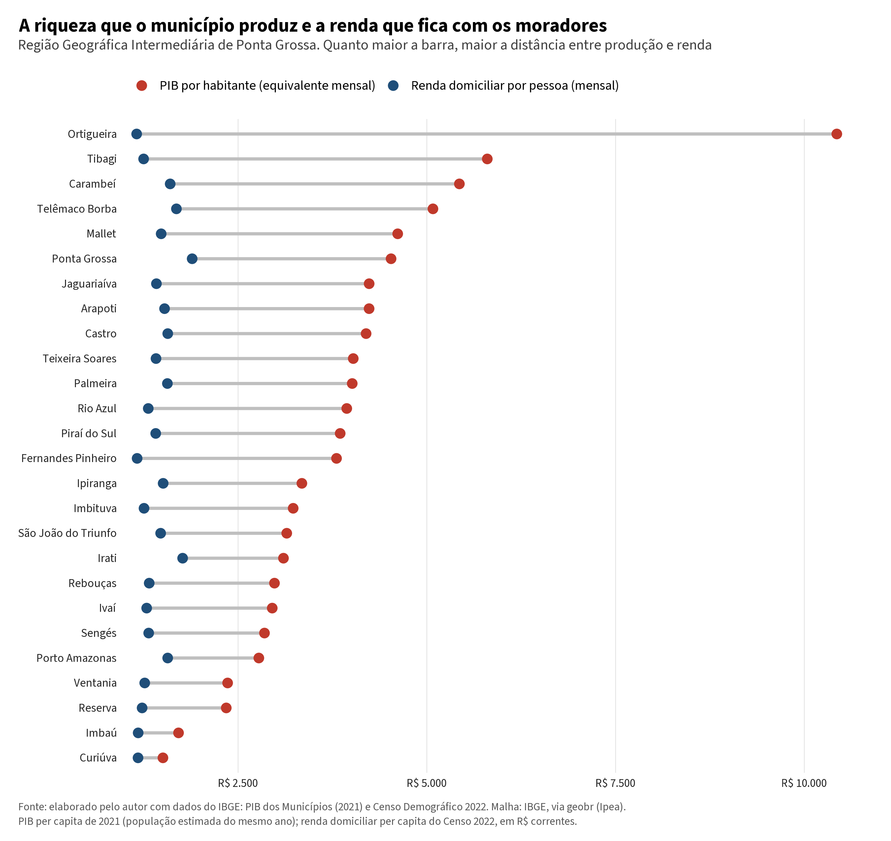
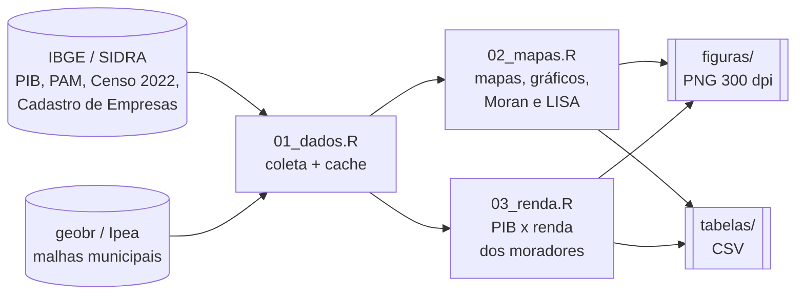
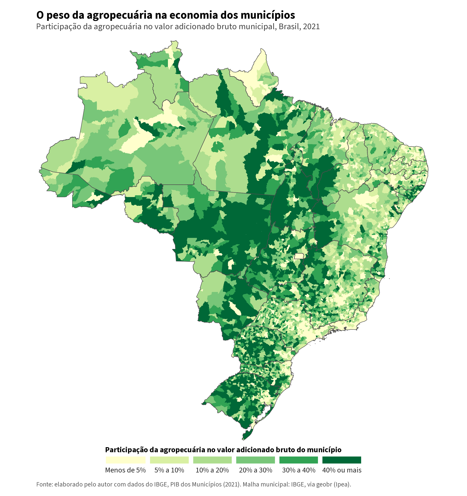
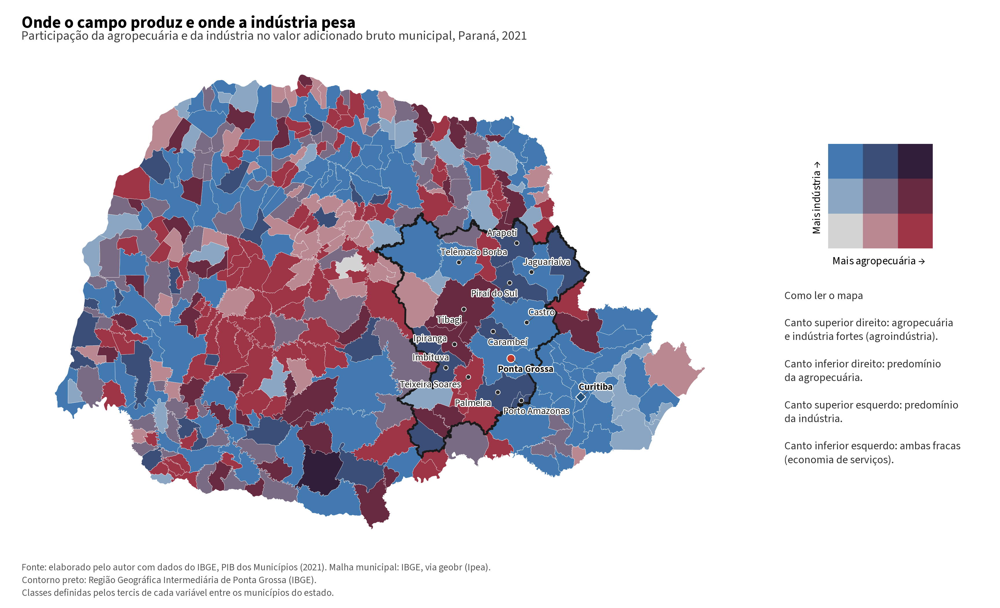
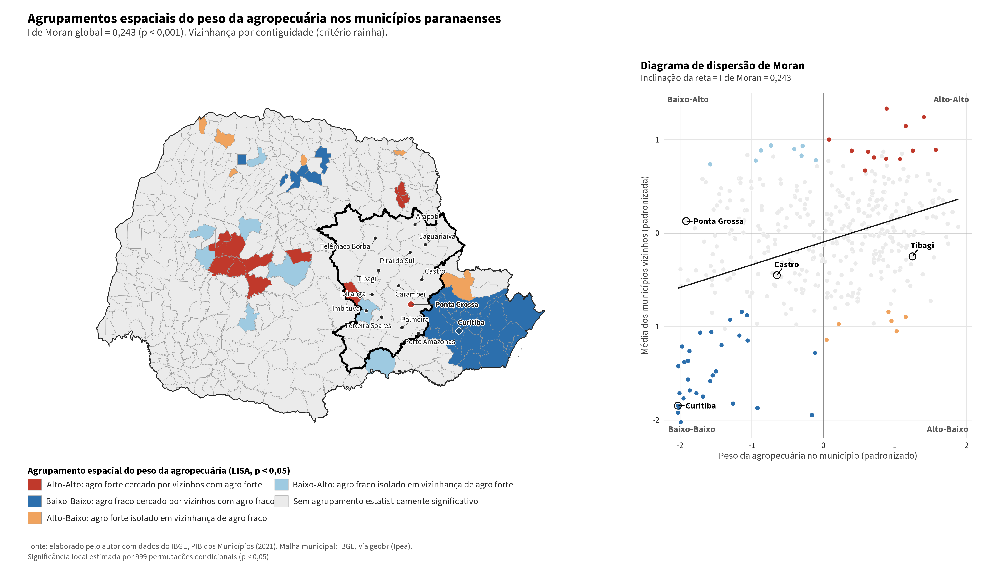
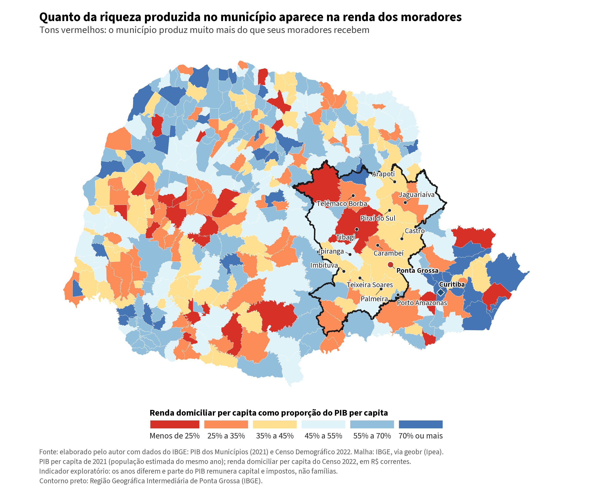
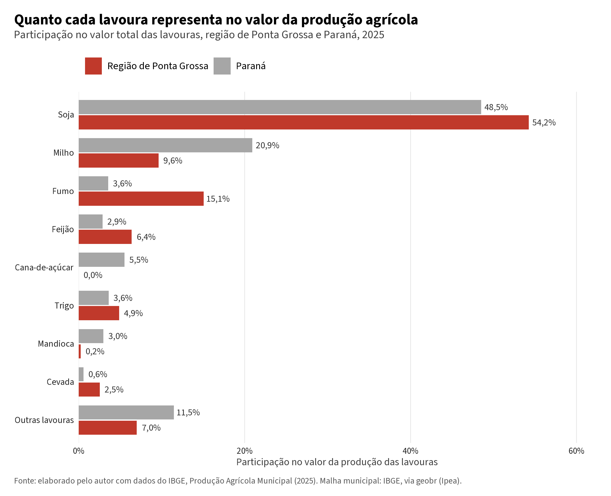
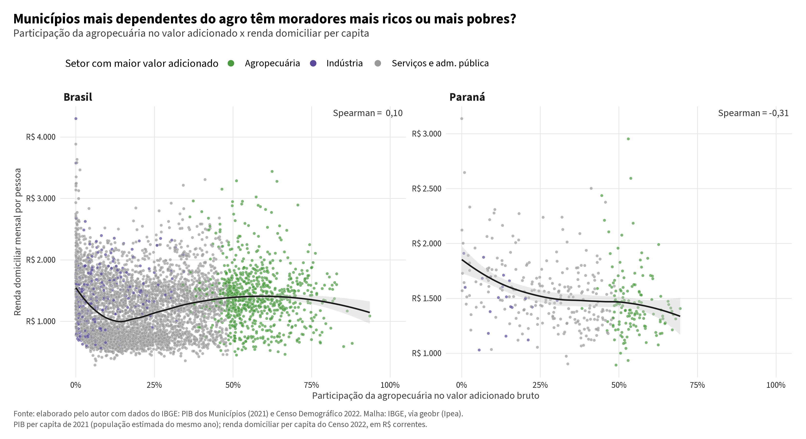

<div align="center">

# Onde fica a riqueza do agro?

**Agropecuária, PIB e renda nos municípios brasileiros — do Brasil ao Paraná, com foco nos Campos Gerais**


-1f4e79)




<sub><i>Ortigueira produz cerca de R$ 10 mil por habitante por mês, mas a renda dos moradores é de R$ 1,2 mil.</i></sub>

</div>

---

## A pergunta

O agronegócio é um dos motores da economia brasileira, mas o valor que ele gera **nem sempre aparece onde é produzido**. Parte dele vira indústria na cidade-polo (laticínios, esmagamento de soja, papel e celulose) e parte remunera capital que vive em outro lugar.

Este repositório mede esse descompasso município a município, em três escalas:

```
Brasil  ──►  Paraná  ──►  Região Geográfica Intermediária de Ponta Grossa (Campos Gerais)
```

## Principais achados (preliminares)

| Achado |
|---|
| **Ponta Grossa** tem só **2%** do seu valor adicionado vindo da agropecuária, contra **40%** da indústria. O agro está nos vizinhos. |
| **Tibagi** e **Castro** são o **3º e o 4º maiores VABs agropecuários do Paraná**, atrás apenas de Cascavel e Toledo. |
| A região tem **duas agriculturas**: soja empresarial (54% do valor das lavouras) e fumo familiar (**15%**, contra 3,6% no estado). |
| Em **Ortigueira**, só **11%** do PIB per capita aparece como renda dos moradores; em **Tibagi**, 21%; em **Ponta Grossa**, 42%. |
| No **Paraná**, municípios mais dependentes do agro têm moradores com **renda menor** (Spearman = −0,31). No **Brasil**, a relação praticamente some (+0,10). |
| O peso do agro é bem mais concentrado espacialmente no Brasil (**I de Moran = 0,50**) do que no Paraná (**0,24**), onde ele é difuso pelo território. |

## Como o pipeline funciona



Todos os dados são **públicos e baixados direto da API do IBGE** pelo próprio código. Nada é editado à mão, então qualquer pessoa reproduz o artigo do zero.

## Como rodar

**Requisitos:** R 4.2 ou superior (RStudio recomendado) e internet na primeira execução.

```r
source("01_dados.R")   # baixa e prepara os dados (só na 1ª vez; depois usa o cache em dados/)
source("02_mapas.R")   # figuras 01 a 12 + análise espacial
source("03_renda.R")   # figuras 13 a 17 + cruzamento com renda
```

Os pacotes que faltarem são instalados automaticamente na primeira execução: `geobr`, `sidrar`, `sf`, `ggplot2`, `dplyr`, `tidyr`, `stringr`, `forcats`, `scales`, `biscale`, `cowplot`, `patchwork`, `spdep`, `ggrepel`, `readr`, `showtext` e `jsonlite`.

> Para forçar um novo download de alguma base, apague o arquivo correspondente em `dados/`.

## Estrutura

```
├── 00_config.R          # pacotes, fonte, tema visual, cache e funções utilitárias
├── 00b_base_mapas.R     # carrega a base e define escalas, cores e rótulos dos mapas
├── 01_dados.R           # coleta: malhas, PIB municipal, PAM, população
├── 02_mapas.R           # figuras 01–12 e LISA (Brasil e Paraná)
├── 03_renda.R           # figuras 13–17: renda, PIB per capita e retenção
├── figuras/             # PNGs em 300 dpi, prontos para o artigo
├── tabelas/             # CSVs com os números citados no texto
└── dados/               # cache dos downloads (fora do Git, gerado pelo 01_dados.R)
```

## Galeria

<table>
<tr>
<td width="50%"><br><sub><b>Fig. 1</b> · Peso da agropecuária no valor adicionado, Brasil</sub></td>
<td width="50%"><br><sub><b>Fig. 4</b> · Onde o campo produz e onde a indústria pesa, Paraná</sub></td>
</tr>
<tr>
<td><br><sub><b>Fig. 9</b> · Agrupamentos espaciais (LISA) e diagrama de Moran, Paraná</sub></td>
<td><br><sub><b>Fig. 16</b> · Quanto da riqueza produzida vira renda local</sub></td>
</tr>
<tr>
<td><br><sub><b>Fig. 12</b> · As lavouras da região de Ponta Grossa x Paraná</sub></td>
<td><br><sub><b>Fig. 17</b> · Peso do agro x renda dos moradores</sub></td>
</tr>
</table>

## Fontes de dados

| Base | Tabela SIDRA | Ano | Uso |
|---|---|---|---|
| PIB dos Municípios (IBGE) | 5938 | 2021 | PIB e VAB por setor |
| Produção Agrícola Municipal (IBGE) | 5457 | mais recente | Valor da produção por lavoura |
| Censo Demográfico 2022 (IBGE) | 10295 | 2022 | Renda domiciliar per capita |
| Cadastro Central de Empresas (IBGE) | 1685 | 2021 | Salário médio do emprego formal |
| Estimativas de População (IBGE) | 6579 | 2021 | PIB per capita no mesmo ano do PIB |
| Malhas territoriais (geobr / Ipea) | — | 2020 | Municípios, estados e regiões intermediárias |

## Limitações conhecidas

- **2021 é o ano mais recente com VAB por setor por município.** O IBGE divulgou 2022 e 2023 sem essa abertura, que deve voltar com a nova série das Contas Nacionais (ano-base 2021).
- **Os anos não coincidem:** PIB de 2021, renda de 2022. O indicador de retenção (fig. 16) é exploratório.
- **PIB mede onde se produz, não onde a renda fica.** Parte do PIB remunera capital e impostos, não famílias.
- **Correlação não é causalidade.** Os cruzamentos descrevem padrões; a próxima etapa é um modelo de regressão espacial.
- **Cachoeira Dourada (GO)** foi excluída das participações setoriais por ter VAB total negativo em 2021.

## Próximos passos

- [ ] Alinhar a PAM em 2021 nos cruzamentos com o PIB
- [ ] Regressão espacial: renda ~ agro + indústria + PIB per capita (`spatialreg`)
- [ ] Mapas de participação por cultura na região (soja, fumo, milho, feijão)
- [ ] DOI do código via Zenodo

## Como citar

> Artigo em preparação. A referência completa será adicionada após a publicação.

---

<div align="center">
<sub>Feito com dados abertos do IBGE nos Campos Gerais.</sub>
</div>
